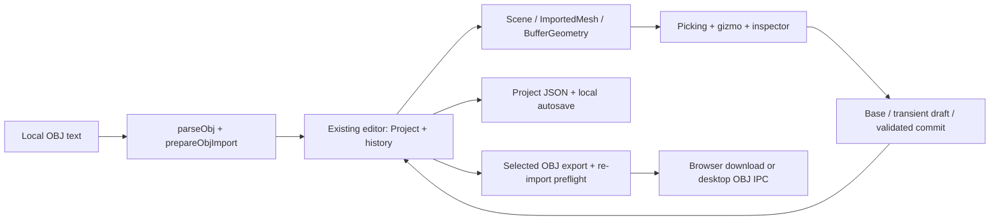
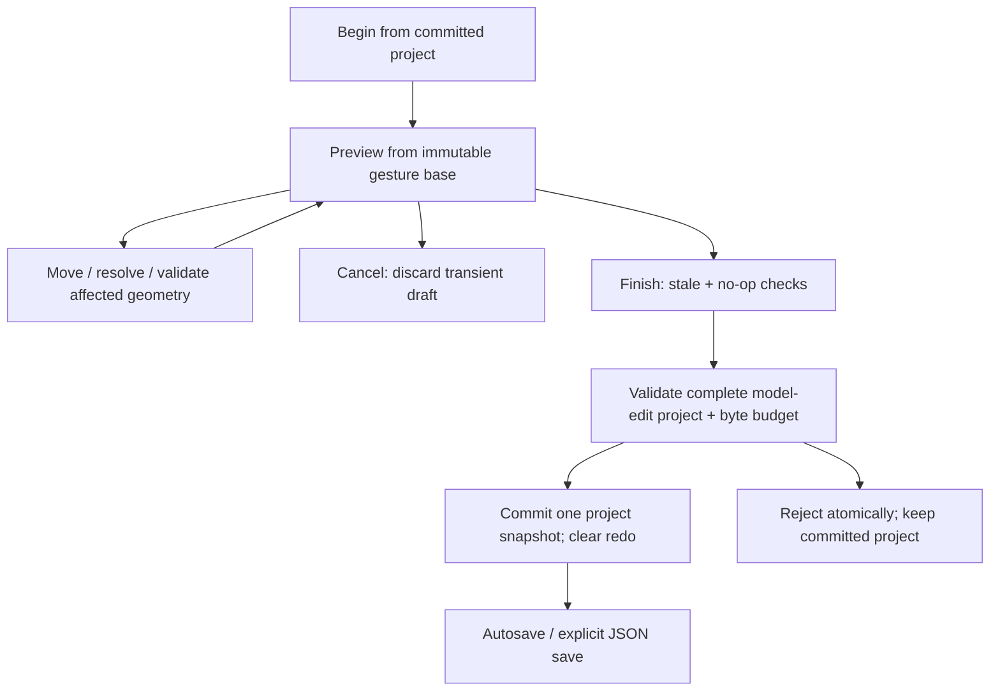

# OBJ Editor — Technical Documentation

This is the implementation reference for Stages 1–5E on `feature/obj-editor`. For a guided workflow, see the [user guide](obj-editor-user-guide.md). Historical measurements and investigation details remain in the [audit reports](#validation-and-evidence).

**Integration status: reviewable as a Draft PR, not ready to merge into the current `main`.** This branch implements project JSON and 60-entry in-memory history. The newer main-branch history, checkpoints, `.aeproj` packages, start screen and IndexedDB document lifecycle are **not integrated**. See [integration considerations](#integration-considerations).

## Overview

The OBJ Editor adds restricted Wavefront OBJ interchange and topology-preserving mesh translation to Aero P15's existing multi-UAV scene. Imported geometry uses the existing project, model list, selection, scene renderer and transaction/history infrastructure. It does not create an independent editor scene or a second project store.

The supported workflow is import → place the object → select and translate mesh elements → Undo/Redo or cancel → save the complete project → export the selected OBJ → re-import for geometric comparison. Building geometry remains independent of UAV trajectories and viewpoints. Current route analysis does not use edited triangles for collision detection, visibility analysis or path planning.

This is a focused mesh-translation editor. It does not implement topology creation/deletion, extrusion, welding, mesh rotation/scaling in Edit Mode, material authoring, arbitrary OBJ compatibility or a general Blender replacement.

## Feature summary

| Area | Implemented behavior |
| --- | --- |
| Import | Local `.obj` input; one model instance per file; multiple submeshes; logical vertex identities and supported corner UV/normal data |
| Scene integration | Existing object list, viewport selection, focus, visibility, locking, duplication and model deletion |
| OBJ Object Mode | World XYZ translation; XYZ Euler orientation; positive local-axis scale; centre-pivot gizmos and numerical controls |
| Built-in Object Mode | Building, cuboid and cylinder translation, Y-axis yaw and physical XYZ dimensions; original bottom-anchor semantics |
| Edit Mode | Vertex, edge and triangular-face selection/translation for an eligible imported OBJ |
| Multi-selection | Shift-click toggle within one object, submesh and element type; translate the unique union of logical vertices |
| Numerical editing | Object transforms; absolute local reference position for a single element; local delta plus Apply for a group |
| Transactions | One history entry per completed drag or numerical operation; cancellation, invalid-draft rejection and atomic capacity checks |
| History | 60 project snapshots; exact reference-based Undo/Redo; previews and selection changes do not add entries |
| Persistence | Version 1/2 project JSON; inline geometry; most-recent-project localStorage autosave; desktop atomic JSON writes and browser download/restore |
| OBJ export | Selected imported OBJ only; object transform baked once; supported UVs, normals, submesh ordering and triangle connectivity; exact importer preflight |
| Optimizations | Resource-owned topology cache, immutable sharing, lazy authored-normal copies, unaffected render-buffer reuse and renderer-retainer correction |

UAV transformations and built-in/UAV OBJ export are not implemented. Built-in `size` values remain dimensions in metres; they are not reinterpreted as OBJ scale factors.

## Architecture

### Source map

All paths below are relative to the repository root.

| Module | Responsibility |
| --- | --- |
| [`src/core/types.ts`](../src/core/types.ts), [`obj-resource.ts`](../src/core/obj-resource.ts) | Serializable project/resource types, strict resource validation and detached validation copies |
| [`src/features/obj-import/obj.ts`](../src/features/obj-import/obj.ts) | Restricted text parser; bounds checks; preparation and complete-project validation before import commit |
| [`useObjImport.ts`](../src/features/obj-import/useObjImport.ts) | File-input lifecycle, busy guard and import feedback |
| [`geometry.ts`](../src/features/obj-import/geometry.ts), [`ObjMesh.tsx`](../src/features/obj-import/ObjMesh.tsx) | Expanded runtime corner buffers, bounds/normals, memoized submesh rendering and owned-geometry disposal |
| [`src/core/obj-transform.ts`](../src/core/obj-transform.ts), [`model-transform.ts`](../src/core/model-transform.ts), [`model-bounds.ts`](../src/core/model-bounds.ts) | OBJ matrices/pivot compensation, built-in dimension/yaw adapter and focus/control bounds |
| [`src/features/obj-transform/`](../src/features/obj-transform/) | Shared ObjectGizmo and numerical TransformInspector |
| [`src/core/mesh-edit.ts`](../src/core/mesh-edit.ts) | Element identities, topology cache, picking helpers, selection resolution, immutable translation and normal transport |
| [`src/features/mesh-edit/`](../src/features/mesh-edit/) | VertexOverlay for all three selection types; VertexInspector for single/group numerical editing |
| [`src/core/transform.ts`](../src/core/transform.ts), [`editor.tsx`](../src/core/editor.tsx) | Base/draft transactions, restrictions, synchronous event refs, commit validation and history |
| [`src/Scene.tsx`](../src/Scene.tsx), [`sceneInput.ts`](../src/scene/sceneInput.ts), [`src/App.tsx`](../src/App.tsx) | Existing scene/model integration, input suppression, tools, mode switching and menus |
| [`src/features/obj-export/`](../src/features/obj-export/) | Project-data exporter, round-trip preflight and browser/desktop save adapter |
| [`useProjectSnapshot.ts`](../src/features/obj-import/useProjectSnapshot.ts), [`src/features/modules.tsx`](../src/features/modules.tsx) | Current JSON file fallback when the optional project-files module is absent |
| [`desktop/obj-files.cjs`](../desktop/obj-files.cjs), [`files.cjs`](../desktop/files.cjs), [`main.cjs`](../desktop/main.cjs), [`preload.cjs`](../desktop/preload.cjs) | Dedicated OBJ IPC, request/extension validation, shared file-operation guard and atomic file writing |



### Resource representation and identity

A version 2 project embeds `objResources`. An OBJ model references one resource by `resourceId`.

```ts
type ObjResource = {
  id: string;
  name: string;
  format: "obj";
  vertices: { id: string; position: [number, number, number] }[];
  meshes: {
    id: string;
    name: string;
    triangles: number[];
    uvs?: number[];
    normals?: number[];
  }[];
};
```

Positions are resource-local metres, with +Y up. Each consecutive triple in `triangles` indexes `vertices`. UVs contain two numbers per triangle corner; normals contain three. This supports a shared logical position with independent attributes across hard edges or UV seams.

Vertex IDs are stable within a resource. Equal coordinates do not imply equal identity and are never automatically welded. GPU buffers expand triangle corners; their indices are not editable vertex identities. Submesh IDs are resource-local. Original polygon boundaries and material metadata are not retained.

The current selection is transient UI state:

- Vertex: `modelId`, `meshId`, `vertexId`.
- Edge: `modelId`, `meshId`, `kind: "edge"`, unordered pair of logical vertex IDs (`edgeIds`).
- Face: `modelId`, `meshId`, `kind: "face"`, triangle ordinal (`triangle`).
- A group retains the primary element and an optional `additional` collection. Canonical element keys remove duplicate membership.

Selection is not serialized or stored in project history. Changing the element type/submesh clears element membership. Reload restores committed geometry, not an active edit selection or drag.

### Transforms, rendering and ownership

An OBJ object's matrix is `T(position) · R(XYZ degrees) · S(scale)`. Absent `rotationXYZ`, legacy yaw means `[0, rotation, 0]`; absent scale means `[1,1,1]`. When XYZ rotation exists, scalar `rotation` mirrors its Y component. OBJ `size` is the import bounds descriptor, not a scale control. Geometry is neither recentered nor grounded on import.

Object translation uses world axes. Object rotation/scale controls use local axes and preserve the transformed local bounding-box centre, compensating the model origin position. Numerical Position fields edit that origin directly; position can therefore change as a consequence of centre-pivot rotation/scaling. OBJ negative Y is allowed. Built-ins retain their distinct bottom-anchor, nonnegative-Y, yaw-only and dimension semantics.

`ImportedMesh` creates a non-indexed `BufferGeometry` from logical triangles and supported corner attributes. Missing authored normals are computed for runtime shading. The neutral material is double-sided; retained UVs do not load textures. Rendering uses Float32 buffers, whereas project numbers remain JavaScript numbers. The component owns and disposes its geometry. Unaffected submeshes can retain buffers when referenced vertex objects and mesh data are unchanged.

Instances can share an immutable resource after duplication. Geometry edits detach the active instance with a transaction-reserved resource ID when necessary. Unchanged vertex objects, triangles, UVs and unchanged meshes remain shared. Deleting the last referencing model removes its resource from the current snapshot; older history snapshots retain data until evicted. Pre-existing unattached resources are not generally purged.

### Transaction and persistence flow



Synchronous refs let native events read the latest committed transaction state before React/R3F context propagation completes. Previews always derive from the gesture base, avoiding accumulated numerical drift. Invalid samples retain the last valid preview. Escape, blur and mode changes cancel the active gesture. A stale, canceled or no-op completion adds no history.

The current branch stores `{ past: Project[], present: Project, future: Project[] }`, capped at 60 past snapshots. Undo/Redo moves references and cancels transient editing; it does not clone the entire resource graph. Starting another edit after Undo discards the redo branch.

`validateProject`, `parseProject` and `serializeProject` handle version 1 and version 2. Legacy version 1 remains valid without automatic upgrade; adding OBJ creates version 2. Version 1 cannot carry OBJ resources, and OBJ instances must reference an existing resource. Unknown version 2/resource extensions are rejected. Older version-1-only builds cannot restore these version 2 projects.

Explicit saving writes a complete `.p15.json` snapshot through the current file fallback. Browser preview downloads JSON; desktop uses its JSON IPC. Autosave stores the most recent committed project at `p15.project.v1` after 450 ms, subject to storage availability. Neither JSON files nor autosave include the 60-step Undo/Redo stack. Failed autosave retains the old stored value and reports an error; keep an explicit project file before closing. The optional project-files module, if later installed, takes precedence and requires separate compatibility review.

Export serializes the selected OBJ's project data, not the render scene: no UAVs, helpers, grid or gizmos enter the output. It preserves logical vertex order and triangle connectivity, writes supported groups/attributes, bakes the object matrix once and transforms normals with the inverse-transpose normal matrix. Re-imported exported vertices are already in world placement and receive an identity object transform. Normals are normalized; OBJ interchange is geometric/attribute compatibility, not preservation of all source text or editor IDs. A fresh import creates new resource/instance identities.

Before any file write, export runs the exact importer against an empty project. Unsupported geometry, naming, coordinates or expanded project capacity cause explicit refusal. Desktop `p15:save-obj` does not change the current project document path. Cancellation returns without changing the project or history.

## Editing semantics

| Selection | Vertices translated | Single-element reference |
| --- | --- | --- |
| Vertex | The referenced logical vertex | Vertex position |
| Edge | Both endpoint vertices | Edge midpoint |
| Face | The triangle's distinct vertices | Triangle centroid |
| Group | Unique union of all member vertices | Mean position of unique selected vertices |

A shared vertex moves once even if several selected edges/faces contain it. This unique-vertex centroid is not an average of element centres weighted by membership. Every triangle referencing an affected logical vertex follows, including references in other submeshes of the same resource. Coincident independent IDs do not move together unless selected.

Viewport picking is scoped to the active object/submesh/type. Vertices use a 10 CSS-pixel tolerance, edges 8 pixels, with visibility checks. Faces use visible ray hits and triangle ordinals. There is no X-ray selection. Triangulated quads have an editable diagonal and two independent face selections. Plain click replaces selection; Shift-click toggles membership; a valid empty-space pick clears it. Gizmos have interaction priority. Coincident-element controls expose alternative IDs and can append alternatives to a group.

Mesh gizmos translate along world XYZ. The target pivot is converted through the inverse object matrix to a local target, so rotation and non-uniform scale are respected. Element selection and group resolution are shared by gizmo and numerical paths.

Single-element inspector coordinates are **absolute local reference coordinates**. Setting an edge midpoint or face centroid produces one common displacement for its vertices. Group fields are **local XYZ increments**, applied together with **Apply Translation** (`应用平移`). They reset after success and when a history change clears a nonzero pending delta. Negative group components are valid within geometry limits. Object placement/scale are not overwritten by local mesh edits.

Affected triangles are checked for degeneracy; all moved positions and resource bounds are checked. Fully translated triangles retain their authored corner normals. For partially changed triangles, corner normals are transported using the old-to-new face orientation, preserving separate corner relationships without smoothing across faces. A normal array is copied only when exact values change; absent normals remain absent in the resource and are computed in render buffers.

These checks do not establish collision freedom, watertightness, consistent global orientation or absence of self-intersections. Structural project validation can retain pre-existing degenerate triangles; OBJ parsing and affected-triangle editing impose their additional geometric checks. An invalid sample or over-budget commit must never partially apply a selected group.

## Performance and memory

Stages 5A–5C measured and optimized existing paths. The table summarizes particular workloads, not universal model-size or frame-rate guarantees.

| Measurement | Observed result | Evidence |
| --- | --- | --- |
| 45,000 triangles, 100 edges, no authored corner attributes: absolute CPU preview median | 46.213 → 3.655 ms (12.64×) | [5B](obj-editor-topology-optimization.md) |
| Same large topology: cold first edge query median | 27.80 → 57.27 ms; first-use cost increased while repeated queries improved | [5B](obj-editor-topology-optimization.md) |
| 60 normal-preserving edge edits on attributed 45,000-triangle grid: retained heap above warmed state | 197.29 → 11.89 MiB | [5C](obj-editor-history-memory.md) |
| Same count with normal-changing edits | About 197.29 MiB retained; necessary changed normal arrays remain | [5C](obj-editor-history-memory.md) |
| 5E attributed large-case native preview / commit | p50 83.1 / 79.7 ms; p95 118.0 / 89.8 ms | [5E](obj-editor-undo-reliability.md) |

Primary comparisons used Apple M3 Pro, arm64 macOS, 18 GiB RAM, Node v25.9.0 and Electron 45.2.1. CPU benchmarks used three warm-ups and fifteen samples; nearest-rank p95 at that size is the observed maximum. Native UI tests used a hidden 1440×1000 development window and two-RAF/render-buffer observations. WebGL submission time, UI propagation latency, GC-retained heap, process memory and physical GPU memory are different quantities. These results do not establish displayed production FPS.

The private `WeakMap<ObjResource, ...>` caches derived vertex-ID lookups, referenced indices and edge collections/maps. It is keyed by immutable resource object identity, never only a resource ID. Values hold IDs/indices, not positions, vertex objects or project/history references. Published collections are read-only/frozen. Translation privately inherits the cache because identities/connectivity do not change. Import, restoration, replacement and any future topology-changing operation must obtain a fresh cache entry. Dynamic positions, normals, bounds and pivots are not cached there.

History shares unchanged objects/arrays; normal-changing edits still copy necessary normal data. Stage 5C also moved a long-lived background cleanup outside a shared component closure that retained old editor history. Stage 5E's renderer test confirmed resource, normal-array and discarded-redo collection after eviction, even with the pure edge table held. A count limit and 5 MB file limit do not bound total heap/GPU usage. Dense submesh picking, buffers, normal transport and serialization remain significant costs.

## Validation and evidence

The latest implementation checkpoint is Stage 5E (`2419530`). Its [verification manifest](audits/obj-editor-5e-verification.json) records TypeScript success, **123/123 automated unit/integration tests**, a successful production build and **17 passing serial Electron invocations** with fresh profiles. Three runs used the unchanged original 50 ms continuous 60-Undo/60-Redo workload; 35 ms, 120 ms, batched and production-bundle cases also passed exact geometry checks. These are recorded implementation results, not a claim that the latest main branch has been integrated or tested.

The 5E defect was an input-driven chain of passive updates: a fresh zero delta array and repeated autosave-saving notification left work queued behind rapid history input. The correction makes group reset idempotent and marks dirty state inside the history transaction. It does not throttle inputs, change history capacity, disable StrictMode or suppress warnings. See [root cause, ablations and before/after evidence](obj-editor-undo-reliability.md).

Tests cover parser/serialization failures, logical identity, UV/normal seams, coordinate conversion, unique group membership, copy-on-write, transaction/history invariants, cancellation, restrictions, buffers, capacity rollback, file adapters, UAV poses and route-analysis preservation. Electron suites exercise actual pointer/key events, browser downloads/restoration and some injected public-API fixture setup. React/R3F inspection is test-only. Stubbed OS dialogs with real temporary file I/O do not replace physical packaged-dialog acceptance.

| Report | Purpose |
| --- | --- |
| [5A audit](obj-editor-audit.md) | Original architecture/performance findings; historical unresolved findings must be read with later reports |
| [5B topology optimization](obj-editor-topology-optimization.md) | Cache design, CPU/UI comparisons and resolution of the earlier pivot-observation race |
| [5C history memory](obj-editor-history-memory.md) | Normal sharing, closure-retainer correction, GC and remaining normal-changing cost |
| [5D release readiness](obj-editor-release-readiness.md) | Authored versus generated assets, restrictions, capacity and application integration evidence |
| [5E Undo/Redo reliability](obj-editor-undo-reliability.md) | Confirmed cause, narrow fix, repeated stress regressions and manual checklist |

5D tested raw KayKit buildings separately from explicit diagnostic derivatives. Raw files failed unsupported material/smoothing/polygon rules; conditioned files passed. The optional large Sibenik architectural sample was not accepted. Synthetic large buildings demonstrate controlled capacity, not general BIM/scan compatibility. Asset provenance and licenses are in the [fixture README](../tests/fixtures/obj-release/README.md).

Before merge, manually check packaged native dialogs/cancellation/overwrite/errors, platform menu shortcuts, rapid history during real interaction, app/modal focus changes, restart/restoration, target-machine responsiveness and a real business building. Current source tests do not prove these physical OS workflows. `npm run build` creates the renderer bundle, not a packaged Electron installer.

## Limitations and supported input profile

| Item | Current contract |
| --- | --- |
| Positions | `v x y z`, exactly three finite Float32-representable values; local coordinates within ±10,000 m |
| Attributes | `vt u v` exactly two values; `vn x y z` nonzero; complete and consistent optional layouts within each submesh |
| Faces | Nondegenerate triangles and strictly convex planar quads; quads split on corners 1–3; all other polygons rejected |
| Indices | Nonzero positive/negative integers referencing declarations already read; no forward references |
| Grouping | `o` and single-name `g`; object/group labels at most 70 characters; a boundary starts a submesh when a face follows |
| Smoothing | Only `s off` and `s 0`; no numbered smoothing groups |
| Text | Comments, BOM, LF/CRLF, whitespace and scientific notation accepted; no continuation lines; content line limit 4,096 characters |
| Unsupported directives | Materials/MTL, textures, lines, points, free-form surfaces, extra vertex components/colors/weights and unknown commands cause errors |
| Input/output OBJ budget | 16,000,000 UTF-8 bytes; input name at most 160 characters |
| Project budget | 5,000,000 UTF-8 bytes for the full current project, including geometry and background; a small OBJ can expand past it |
| Scene dimensions | Up to 500 models; imported/edited resource single-axis size at most 10,000 m |
| Transform limits | OBJ positions/rotation components bounded to ±10,000; positive scale 0.01–10,000; no mirrored/zero scale |
| Edit eligibility | Visible, unlocked imported OBJ; no preview, playback, candidate plan or drone camera view; one active object/submesh/type |
| Edit tools | Translation only; no topology deletion, insertion, extrusion, welding, group rotation/scale or cross-object selection |
| Export eligibility | Selected imported OBJ only, from committed data; active transform/candidate blocks export; hidden/locked selected OBJ can export |
| Persistence | Current JSON and latest local autosave only; Undo/Redo stack, active selection and drag are not persisted |

Export preflight can refuse a project that currently fits because baked decimal coordinates/normals increase the re-imported JSON. Capacity rejection is atomic, with no partial group or file write. Extreme scales, distant origins and thin geometry can exceed practical clipping/picking precision even within data limits. Explicit errors do not constitute automatic repair or simplification.

## Integration considerations

Rechecked against `origin/main` **`008c5fb`** on 2026-11-21, with feature implementation **`2419530`**. The branches diverge from `1320078`. An isolated merge-tree check reports content conflicts in:

- `desktop/errors.cjs`
- `desktop/files.cjs`
- `desktop/main.cjs`
- `src/core/editor.tsx`
- `src/core/transform.ts`
- `src/features/modules.tsx`

No conflicts were resolved during documentation preparation. Dependency manifests/lockfile have no feature changes. Textually automatic merges also need semantic review.

| Contract | This feature branch | Current main; integration work still required |
| --- | --- | --- |
| History | Project snapshots, 60 past entries | `HistoryEntry { project, label, at }`, shared 50-step limit; agree on capacity and adapt transactions without silently weakening invariants |
| Checkpoints/timeline | Not implemented here | Main has checkpoints, history jump and session lifecycle; OBJ resources must survive every stored state |
| Document format | `.p15.json`, version 1/2 scenes | `.aeproj` packages and `useDocuments()`; reconcile fallback ownership and metadata, including currently fixed `projectVersion: 1` |
| Autosave | Editor-owned latest-project localStorage | Document-owned full-session IndexedDB; port the 5E scheduling invariant rather than copying obsolete persistence code |
| Startup/restoration | Direct scene and JSON/local snapshot restore | Start screen, recent projects and session restoration; update harness entry/recovery paths |
| Scene compatibility | Strict OBJ version 2 extension | Validate legacy scenes, OBJ v2, package current/history/checkpoint states and package round trips |

The main-branch handoff is not present in this checkout; read its pinned [history and `.aeproj` handoff](https://github.com/CSDECADE/UNNCGRP-17/blob/008c5fbc6b5272a84cd45f6710619c4a5d510919/docs/handoff-history-aeproj.md) and [package format](https://github.com/CSDECADE/UNNCGRP-17/blob/008c5fbc6b5272a84cd45f6710619c4a5d510919/docs/aeproj.md).

Main's document effect also schedules a saving notification after history changes. This requires combined stress verification; it is not evidence that the combined defect has already reproduced. Preserve native OBJ IPC alongside new package IPC and recent-document behavior. Preserve main's path-array import and the existing UAV behavior. Branch-only passing tests do not establish combined application correctness.

## Developer maintenance guide

### Modify behavior at its ownership boundary

- Extend parsing/export in the interchange modules, with explicit supported syntax and paired round-trip tests.
- Change element identities/resolution in `mesh-edit.ts`, and update overlay/inspector behavior together. Keep render indices out of saved selection identity.
- Route edits through existing begin/update/finish/cancel APIs. Derive drafts from the original base and commit the full group once; retain stale/no-op and complete-project validation guards.
- Never mutate committed resources, cached collections or historical normal arrays. A topology-changing extension would require new invalidation/identity rules and separate authorization.
- Preserve copy-on-write isolation, unchanged buffer reuse and explicit owned-geometry disposal. Do not let cache values or long-lived closures retain project/history graphs.
- Keep OBJ object factors separate from built-in dimensions/yaw. Preserve restrictions and cancellation when touching shared scene input.

### Run checks

From the repository root, use the project's Node requirement (22.13+, with Node 24 LTS recommended in README), then:

```sh
npm ci
npm run check
npm test
npm run build
```

For the complete current native regression matrix, start servers in separate terminals:

```sh
npm run dev:web -- --port 5180 --strictPort
node node_modules/vite/bin/vite.js preview --host 127.0.0.1 --port 5181 --strictPort
```

Then run the verified serial runner (it removes `ELECTRON_RUN_AS_NODE` for child Electron processes):

```sh
node scripts/validate-undo-reliability.cjs http://127.0.0.1:5180/ http://127.0.0.1:5181/ /tmp/obj-undo-validation
```

It runs three original continuous stress repeats, alternate intervals, batching, production stress, the focused history-state scenario, seven original suites, pointer latency and renderer memory. It creates isolated profiles/logs and does not stop the servers. A failure remains a nonzero result. This uses a desktop-capable environment; it is not a claim of headless CI portability.

For an individual import suite (macOS/Linux launcher form):

```sh
env -u ELECTRON_RUN_AS_NODE node node_modules/electron/cli.js scripts/verify-obj-ui.cjs http://127.0.0.1:5180/
```

The transform harness `scripts/verify-obj-transform-ui.cjs` accepts default, `builtin`, `export`, `edit`, `elements`, `multi`, `history`, `release`, `audit` and `memory` modes. The [5E reproduction instructions](obj-editor-undo-reliability.md#reproduce-verification) cover the original release stress environment variables.

Focused optional CPU/GC measurements:

```sh
node --expose-gc --experimental-strip-types scripts/benchmark-mesh-topology.mjs --out /tmp/obj-topology.json
node --experimental-strip-types scripts/benchmark-history-memory.mjs --probe --out /tmp/obj-history.json
node --experimental-strip-types scripts/validate-obj-release.mjs --out /tmp/obj-corpus.json
```

Check each script's existing options before changing workloads. Run CPU and UI benchmarks serially; do not infer frame rate from synchronous function timing. Preserve workload, warm-up, sample count and GC conditions for comparisons.

### Investigate a geometry or history failure

Start with the small [building fixture](../tests/fixtures/obj-building.obj). Record build/commit, source-file hash, active instance/submesh/type, selected logical IDs, object matrix and operation. Compare committed project data before/after cancellation, Undo/Redo and JSON restore. Resolve the exact unique vertex union before inspecting runtime corner buffers. Check every submesh referencing shared IDs, corner UV/normal lengths, affected-face normals and copy-on-write resource ownership.

For export, compare baked world positions and triangle order after an identity-transform re-import; do not compare new editor IDs or original OBJ text byte-for-byte. For a history failure, preserve the failing native event rate and exact geometry assertions. Separate context/pivot readiness, state dispatch and GPU observations. Re-run with fresh profiles, retain errors, and use test-only tracing rather than adding production debug hooks or silently dropping keyboard input.
